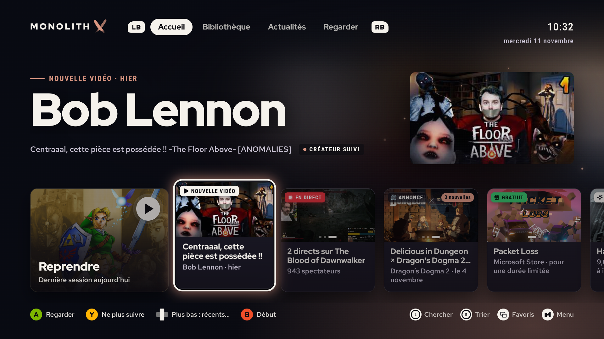
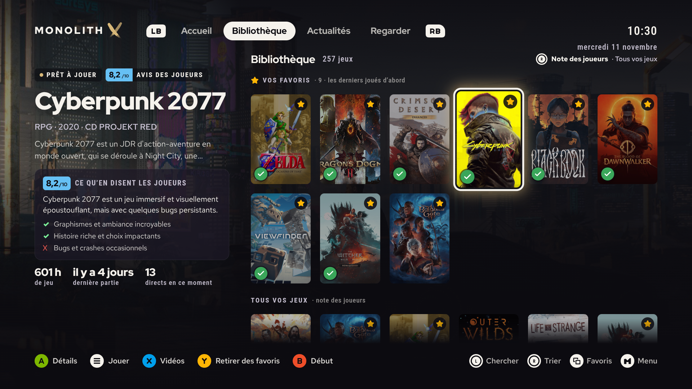
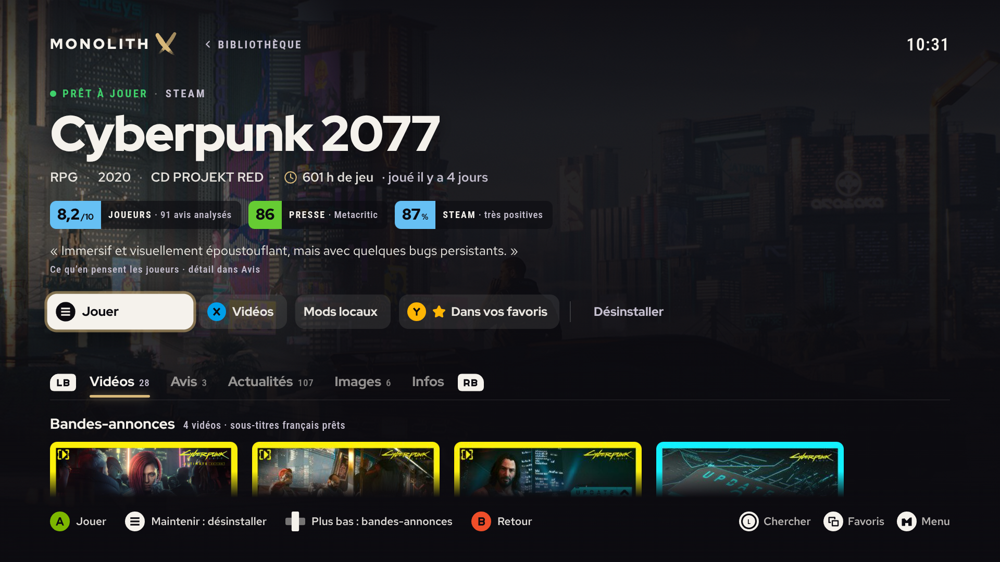
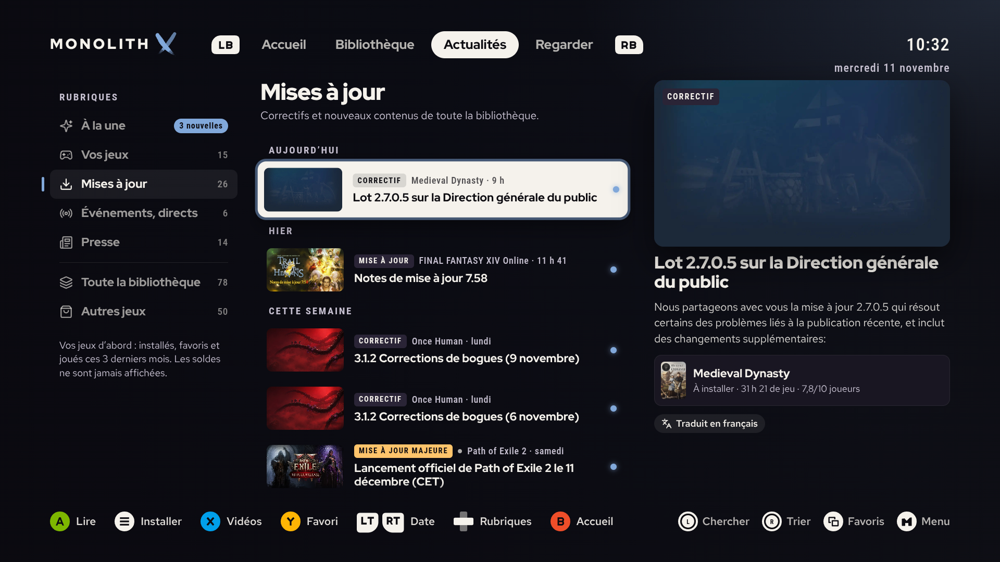
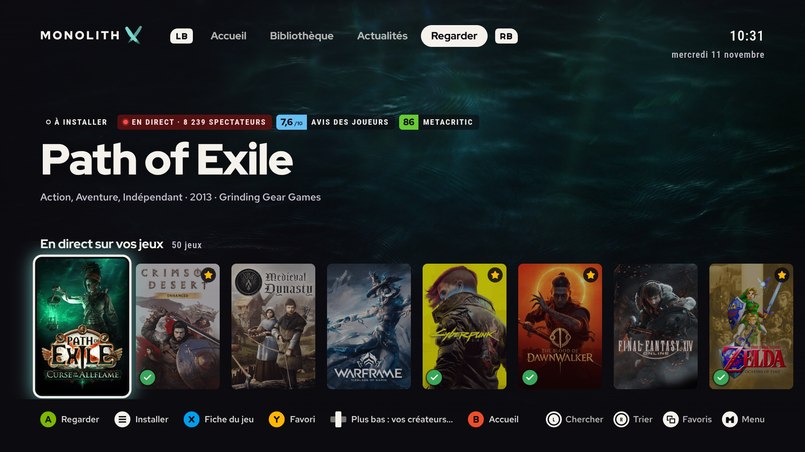
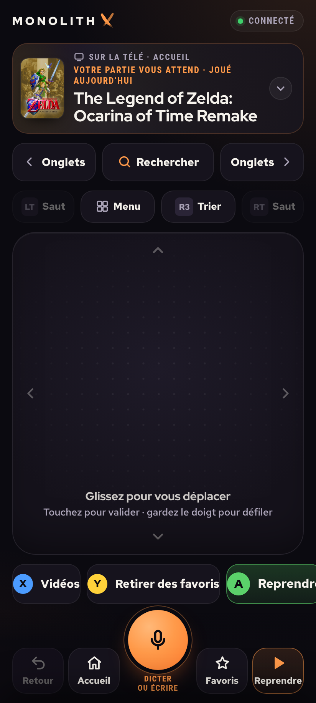
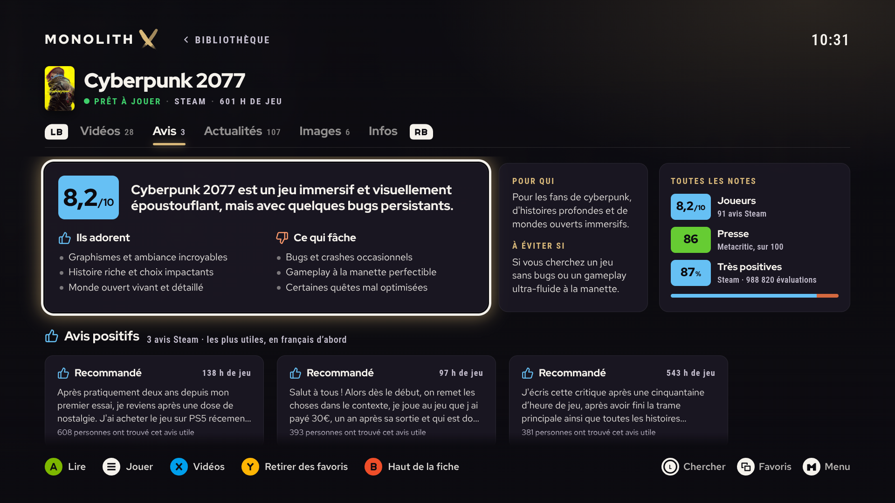

<h1 align="center">电脑已经有了，客厅也有了。</h1>

你的游戏、你关注的创作者、你的闲暇时光。一个为电视设计的界面。

<b>独立项目 · 测试版准备中</b>

<a href="README.md" lang="fr" hreflang="fr">Français</a> · <a href="README.en.md" lang="en" hreflang="en">English</a> · <a href="README.es.md" lang="es" hreflang="es">Español</a> · <a href="README.de.md" lang="de" hreflang="de">Deutsch</a> · <a href="README.zh.md" lang="zh" hreflang="zh">简体中文</a> · <a href="README.pt.md" lang="pt" hreflang="pt">Português</a> · <a href="README.it.md" lang="it" hreflang="it">Italiano</a>

## 我为什么开始做这个

我有电脑，也有电视。我只是想在客厅玩游戏，不想为了这个再买一台游戏主机。

后来我发现了 Moonlight，开始自己拼一个界面，再一点点加上日常使用中缺的东西。把游戏放在同一个地方，不用挨个打开商店就能查看更新。关注喜欢的创作者，看直播，或者像看电影一样看完一款游戏的故事。重新发现游戏库里已经有的东西，而不是继续买买买。

这就成了 Monolith X。我在家里用它，也利用业余时间开发它。现在，我想把安装做得足够简单，让其他人也能试试，告诉我哪里不好用，一起参与接下来的改进。

## 一个游戏库，还有游戏之外的那些内容

| 你的游戏 | 让人想再玩一会儿的详情页 |
| :--- | :--- |
|  |  |
| 统一游戏库、收藏、筛选、预告片和快速启动入口。 | 游戏信息、视频、剧情电影、评价，以及根据已有集成提供的安装操作。 |

| 看看有什么新动静 | 坐下来，直接看 |
| :--- | :--- |
|  |  |
| 围绕游戏，把资讯、更新、活动和免费优惠放在一起。 | 关注的创作者、直播和内容搜索，坐在沙发上就能找到。 |

## 电视在眼前，手机在手边。

<table><tr><td width="32%"></td><td>

扫描二维码就能打开手机伴侣。控制按钮随手可用，输入文字也不用再和屏幕键盘较劲。

项目还包括翻译字幕、模拟器集成，以及仍在开发中的模组功能。这些功能都保留在测试版里；能否使用，取决于电脑上配置的工具和内容。

界面和安装程序支持<strong>法语、英语、西班牙语、德语、简体中文、葡萄牙语和意大利语</strong>。

</td></tr></table>

## 评价不该只剩一个分数

我想知道玩家到底喜欢什么，又被什么惹烦了。Monolith X 汇集玩家反馈，并提供 AI 辅助生成的摘要。这不代表它能保证评价没有偏见：来源和来源本身的局限，跟摘要一样重要。

## 整套东西怎么运行

**电脑运行游戏 → Sunshine 传输画面 → Moonlight 接收画面。** Monolith X 提供这条链路周围的界面和内容。

项目包含 Tizen 客户端和 Android 伴侣应用。需要合适的局域网和兼容的客户端，目前并不支持所有硬件配置。

本页截图来自我自己的日常安装环境，里面已经配置好了游戏库和账号。全新安装会从你自己电脑上检测到的内容开始。

## 试用测试版

这里是 Monolith X 的项目展示页。源代码和测试安装包暂时保持私有。

已在 openSUSE Tumbleweed 虚拟机中测试安装、识别 Sunshine Flatpak、通过 Moonlight 启动以及鼠标导航。其他用户电脑上的测试还需要继续。

想试用或参与？欢迎在 [Issue](https://github.com/Duperopope/MonolithX/issues/new/choose) 中介绍你的配置和感兴趣的部分。目前还没有公开下载。

## 一起把项目往前推进

有用的反馈包括你的配置、你尝试了什么、预期是什么，以及实际发生了什么。内置表单可以整理反馈，并导出为 JSON。在线发送需要配置好反馈接收服务器；这个准备版本尚未启用在线发送。

我开发时大量使用 AI，没什么好隐瞒的。我学过计算机相关专业，也会处理自己能复现的问题。但从我家里用的这套东西，到一个大家都能省心安装的版本，中间还有不少工作。

我想找愿意测试的人、能一起做事的同好，还有对这个项目或我的经历感兴趣的人。欢迎具体建议，包括 Codex、Claude、本地模型，以及那些你们实际用下来确实有帮助的工具。

**[Samir Medjaher — 我的经历与简历](https://duperopope.github.io/SamirMedjaher/)**

[参与贡献](CONTRIBUTING.md) · [反馈与隐私](docs/FEEDBACK.md) · [安全](SECURITY.md) · [架构](docs/ARCHITECTURE.md) · [路线图](docs/ROADMAP.md)

---

[Sunshine](https://github.com/LizardByte/Sunshine) · [Moonlight](https://moonlight-stream.org) · [Credits / Crédits](docs/THIRD-PARTY.md)
